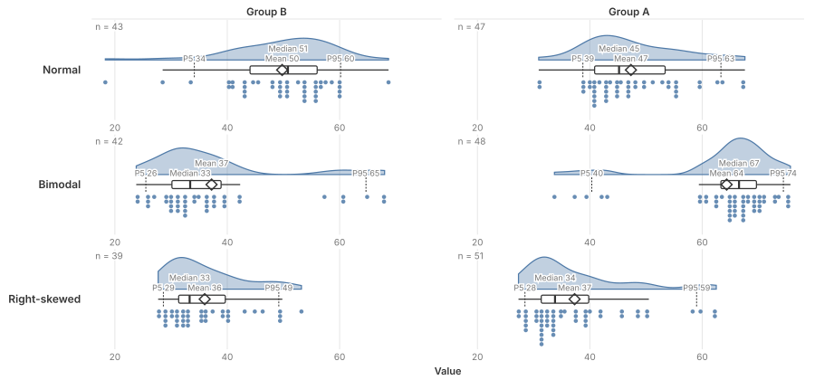
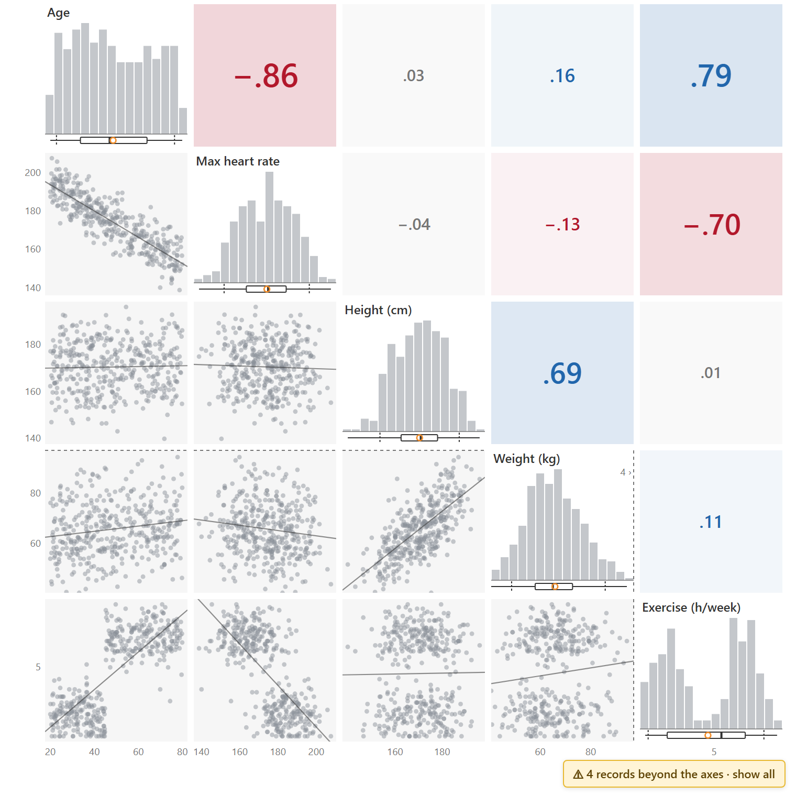

# Tableau viz extensions

Free, open-source Tableau **viz extensions** (custom mark types): chart types Tableau doesn't have built in, made to
feel native. Drag fields onto the Marks card, style them with Format Extension, and keep Tableau's tooltips,
selection and actions.

**[Website](https://okhammahko.github.io/tableau-viz-extensions/)**

| Viz | What it shows | Get it |
|---|---|---|
| **[Raincloud](https://okhammahko.github.io/tableau-viz-extensions/raincloud/)** (1.1) | Each distribution's shape, summary and every record, in a Rows × Columns grid | [`raincloud.trex`](https://okhammahko.github.io/tableau-viz-extensions/raincloud/raincloud.trex) · [demo](https://okhammahko.github.io/tableau-viz-extensions/raincloud/demo/) |
| **[Correlation matrix](https://okhammahko.github.io/tableau-viz-extensions/correlation/)** (0.9 preview) | Every pair of measures as a scatter, each measure's distribution, and how strongly they move together, in words | [`correlation.trex`](https://okhammahko.github.io/tableau-viz-extensions/correlation/correlation.trex) · [demo](https://okhammahko.github.io/tableau-viz-extensions/correlation/demo/) |

To add one: download its `.trex`, then in Tableau (Desktop 2024.2+) **Show Me → Viz Extensions → Access Local Viz
Extensions** → pick the file → follow the prompts. Fine-tune with **Format Extension** (below the tiles). *On Tableau
Cloud or Server, an admin first adds `https://okhammahko.github.io` to the extension allow list.* Your data stays in
Tableau: the extensions draw inside the worksheet and send nothing anywhere.

## Raincloud

A density or histogram **cloud**, a slim **box plot**, and one dot per record as **rain**, in a Rows × Columns grid.

**Fields:** a measure to **Value**, a row ID to **Detail** (one dot per record), and optionally dimensions to
**Rows**, **Columns** and **Colour**.

### Features
- Density (KDE, clipped to the data) or histogram cloud; stacked Wilkinson dot plot or strip rain; Tukey box.
- Native Tableau tooltips and selection per dot; workbook font.
- Rows (≤3) × Columns (≤2) grid with nested headers, wrapping, shared or independent axes; size modes.
- Density: Comfortable / Compact / Dense for long lists and big grids of small multiples.
- Each chart's cloud fills its own height (labelled with its peak share); dots keep one size and compress where
  crowded, so one busy chart never squashes the others.
- Colour tile: Tableau palettes, stable colours, optional split cloud (each colour 100% or its share).
- Outliers cut at whiskers + 5% by default, with a badge that lets viewers show all values.
- Markers: median, an orange mean, P5/P95 with values; field number format; axis title and tick options.
- Optional cumulative line (ECDF) with its own 0–100% scale and a hover readout.

## Correlation matrix (preview)

Scatters below the diagonal, each measure's histogram (or density curve) with a box plot on it, and the coefficient
above it, sized and coloured by strength.

**Fields:** two to eight measures to **Measures** (as `AVG`), a row ID to **Detail** (one point per record), and
optionally a dimension to **Colour**.

### Features
- Pearson r or Spearman ρ; hover any coefficient for both, n, the line's formula and R², and r per colour.
- Plain-language readings ("Strong negative: as Age rises, Max heart rate tends to fall"), with caveats when they
  apply: curved or outlier-driven relationships, colour groups that disagree (Simpson's paradox), few records.
- Look closer: click a number or the ⤢ on a scatter for one pair, large, with marginal histograms and boxes, the
  trend line with its 95% confidence band, a line per colour group and the reading in words.
- Brushing and cross-highlighting: drag a rectangle in a scatter, click a histogram bar or a density cell; hovering a
  point marks the record in every scatter and histogram.
- Big data: above 5,000 records (adjustable) scatters become density cells, still selectable.
- Outliers cut from the axes at the whiskers + 5% (statistics use every value), with a badge to show all.
- Colour tile: split histograms (each colour 100% or its share), a box per colour, stable colours.
- Markers (median, mean, P5/P95) in the field's number format; histogram or density diagonal; tiles or numbers.

This is a **preview** (0.9): feedback welcome in the [issue tracker](https://github.com/OkhammahkO/tableau-viz-extensions/issues).

See [CHANGELOG.md](CHANGELOG.md) for what changed in each version.

## Run from source (developers)
1. `npm install`, then `npm run dev` (raincloud, http://localhost:5173) or `npm run dev:correlation` (http://localhost:5174).
2. **Show Me → Viz Extensions → Access Local Viz Extensions →** `vizzes/raincloud/manifests/raincloud-dev.trex` or
   `vizzes/correlation/manifests/correlation-dev.trex` (both point at localhost) → follow the prompts.
3. Drag fields as above (or turn off Analysis → Aggregate Measures instead of a row ID on Detail).

## Architecture
| Folder | Role |
|---|---|
| `kit/` | Shared toolkit for any Tableau viz extension: Tableau API and settings, grid layout and headers, colours, number formats, dialog and landing-page parts, build preset (see `kit/README.md`) |
| `vizzes/raincloud/`, `vizzes/correlation/` | One folder per viz, same layout: `src/chart` (statistics, rendering; no Tableau calls), `src/extension` (Tableau adapter, landing page), `src/dialog` (Format dialog), `src/harness` (dev harness), `app/` (pages), `manifests/` (dev, preview, sandbox) |
| `raincloud.trex`, `correlation.trex` | The manifests users load (they point at the GitHub Pages copy) |
| `site/`, `.github/workflows/pages.yml` | The website (home page, a page per viz, shared `site.css`); every push to `main` builds it with every hosted extension and live demo and deploys it to GitHub Pages |

## Develop
| Command | What |
|---|---|
| `npm run dev` / `npm run dev:correlation` | Dev servers (:5173 / :5174); harness at `/dev.html` (synthetic data, every option, landing page) |
| `npm test` | Vitest: stats, layout, colours, format, render smoke tests |
| `npm run build` | Type-check and build every viz to `dist/<viz>/` (classic SystemJS scripts for sandbox hosting) |
| `npm run sandbox` | Build, then serve `dist/raincloud/` with Tableau's sandbox server on :8765; load `vizzes/raincloud/manifests/raincloud-sandbox.trex` |
| `npm run site` | Build the website into `dist/site/` (home page, and per viz: its page, hosted extension, `.trex`, live demo) |
| `npm run site:preview` | Build and serve the site on :4180; load `vizzes/<viz>/manifests/<viz>-preview.trex` to test each built extension in Tableau before pushing |
| `python -I scripts/make_synthetic.py` | Regenerate `data/synthetic/` |

Credits and resources reviewed: `CREDITS.md`. See `.claude/CLAUDE.md` (project map), `docs/PLAN.md` (status, decisions, backlog), `docs/RELEASE.md` (release checklist).

## Licences
Our code: MIT (see `LICENSE`). Bundled: Tableau Extensions API (Apache-2.0, `kit/public/lib`),
`@tableau/tableau-ui` (Tableau EULA), React (MIT), d3 modules (ISC).
